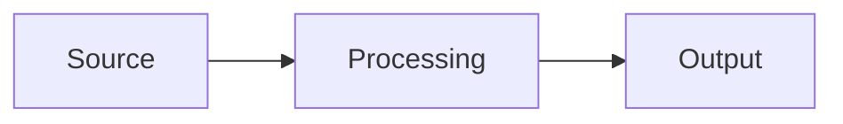

# Demand and P&L Forecasting

Demand and P&L Forecasting is a complete, privacy-first documentation website for documenting this project's data, forecasting, engineering, deployment, and operations lifecycle. It includes 80 editable documentation pages across eight categories.

All project examples are synthetic or generic. The application does not connect to enterprise systems, collect analytics, transmit search queries, or publish itself.

## Technology stack

- React 18
- TypeScript
- Vite
- Tailwind CSS
- React Router
- Lucide React
- React Markdown
- Mermaid.js

## Prerequisites

- Node.js 18 or newer
- npm

## Installation

```bash
npm install
```

## Run locally

```bash
npm run dev
```

Open the local URL printed by Vite, usually `http://127.0.0.1:5173`.

## Production build

```bash
npm run build
npm run preview
```

`npm run build` type-checks the project and creates an optimized static build in `dist/`.

## Project structure

```text
src/
  components/
    layout/
    navigation/
    documentation/
    diagrams/
    search/
  pages/
    Home/
    Documentation/
    NotFound/
  content/
    overview/
    architecture/
    data-ml/
    engineering/
    deployment/
    challenges/
    results/
    resources/
  config/
    navigation.ts
    project.ts
  hooks/
  utils/
  styles/
  types/
public/
  images/
  diagrams/
  assets/
```

## Customize project information

Edit `src/config/project.ts` to change:

- Project name
- Description
- Category
- Status
- Technology stack
- Example repository link

Use only approved, public, fictional, or synthetic values.

## Add a documentation page

1. Create a Markdown file in the appropriate `src/content/<category>/` folder.
2. Add frontmatter metadata:

```md
---
title: "Page Title"
description: "A short description."
category: "Category Name"
order: 81
status: "draft"
lastUpdated: null
tags:
  - topic
---

## Overview

Documentation content...
```

Supported statuses are `draft`, `in-progress`, and `completed`.

3. Add the page title and slug to `src/config/navigation.ts`.
4. Restart or refresh the Vite development server if routing or glob discovery does not update immediately.

The route format is:

```text
/docs/<category-slug>/<page-slug>
```

## Update navigation

Edit `navigationCategories` in `src/config/navigation.ts`. Categories and pages are centralized, and the sidebar, breadcrumbs, previous/next navigation, home quick categories, and documentation count use this configuration.

## Add Mermaid diagrams

Use a fenced code block with the `mermaid` language:

```md

```

Mermaid supports flowcharts, sequence diagrams, architecture diagrams, and other standard Mermaid diagram types. Use only synthetic or approved names.

## Add code examples

Use fenced Markdown code blocks:

```md
```python
def example():
    return "synthetic"
```
```

The renderer adds a language label, syntax styling, horizontal scrolling, and a copy button.

## Add and zoom images

Place an approved image in `public/images/` and reference it from Markdown:

```md

```

Images open in a zoom overlay. Do not upload private or confidential images.

## Theme customization

Theme preference is stored locally in the browser. Tailwind classes in `src/styles/index.css` and component files control the light and dark design.

The primary palette is blue, with slate text and subtle borders. The dark theme uses a navy background.

## Local search

Global search runs entirely in the browser. It searches titles, descriptions, categories, tags, and Markdown content. It sends no query to an external service.

Press `Ctrl+K` or `Cmd+K` to open search.

## Private hosting

The generated `dist/` directory is a static website.

- Use a hosting platform that supports your privacy requirements.
- Configure private access through the hosting or identity provider.
- Do not rely on a client-side password screen for secure access.
- Ensure that secrets and sensitive files are excluded from the repository and build.
- Review the generated `dist/` directory before publishing.

## Privacy and security guidelines

- Never place credentials, API keys, tokens, certificates, private endpoints, or connection strings in source code or Markdown.
- Never bundle secrets into Vite environment variables.
- Use synthetic datasets and generic role names in examples.
- Do not include customer, employee, internal, proprietary, or confidential information.
- Do not add analytics or tracking.
- Do not connect the website to enterprise systems or private APIs.
- Sanitize logs and incident notes before sharing.
- Review all sample code and diagrams before release.

## Troubleshooting

### Page route does not exist

Check that:

1. The Markdown file is under `src/content/<category>/<slug>.md`.
2. The slug matches `src/config/navigation.ts`.
3. The category slug is correct.

### Mermaid diagram fails

Check Mermaid syntax, remove unsupported private labels, and ensure the fence is declared as `mermaid`.

### Build fails

Run `npm run build` and use the TypeScript or Vite error to correct the first reported source issue.
