# Demand and P&L Forecasting Platform

> **Publishing note:** This is a public-safe portfolio case study. Client and region names are generalized. Use actual names, internal architecture, and business figures only on an approved private website.

---

## 1. Homepage

### Enterprise Demand and P&L Forecasting

An end-to-end machine learning platform designed to forecast product demand and key Profit and Loss metrics for a multinational consumer-products organization.

The solution combines statistical forecasting, machine learning, external economic indicators, and automated data pipelines to produce consistent, explainable, and scalable forecasts. It supports both executive-level planning and granular operational analysis.

### Project highlights

- Forecasted demand and five primary P&L components.
- Calculated Net Revenue and Marginal Contribution from forecast outputs.
- Supported top-down and bottom-up forecasting.
- Modeled normalized per-hectoliter values to reduce volume-driven distortion.
- Used regression, tree-based, time-series, and deep-learning models.
- Automated training, scoring, retraining, and accuracy reporting.
- Implemented with Azure Databricks, PySpark, Python, MLflow, and Azure Storage.
- Produced recurring forecasts from the current quarter through year-end.
- Reported approximately 85% historical accuracy across country-level demand and P&L components.

---

## 2. Executive Summary

The project addressed the need for an independent, data-driven demand and financial forecasting capability. Regional planning teams already maintained business forecasts, but stakeholders required a complementary view based on statistical and machine learning methods.

The platform generated forecasts for product volume and the major financial components that determine revenue and contribution. Rather than predicting absolute P&L values directly, the solution primarily modeled monetary values per hectoliter. This normalized the targets and reduced the proportional influence of changing sales volume.

The solution incorporated historical sales, price, cost, calendar, weather, macroeconomic, industry, and exceptional-event information. Multiple candidate models were evaluated, and model selection or ensemble logic was used to produce the final forecasts.

---

## 3. Business Context

Demand and financial planning in the beverage industry is affected by:

- Seasonal consumption patterns.
- Product pricing and discount strategies.
- Weather conditions.
- Macroeconomic changes.
- Product and channel mix.
- Excise duties and taxation.
- Raw-material and distribution costs.
- Promotional activity.
- Exceptional events such as COVID-related disruption.
- Regional and country-level market differences.

Small errors in demand forecasts can flow through the entire financial plan. Over-forecasting can result in excess inventory and inefficient distribution, while under-forecasting can lead to missed sales and supply constraints. Similarly, inaccurate price, discount, tax, or cost forecasts can materially affect revenue and contribution planning.

The project therefore connected demand forecasting with P&L forecasting in one repeatable analytical process.

---

## 4. Problem Statement

The organization needed an automated forecasting platform that could:

1. Produce an unbiased analytical forecast alongside the forecasts prepared by regional planning teams.
2. Forecast demand and financial metrics over a multi-month planning horizon.
3. Support both high-level and granular forecasting.
4. Incorporate seasonal, economic, weather, pricing, and industry signals.
5. Compare multiple modeling techniques instead of relying on one algorithm.
6. Generate forecasts consistently on scheduled business days.
7. Report historical accuracy and explain deviations.
8. Scale across countries, product categories, channels, brands, and SKUs.
9. Support monthly model refresh, scoring, and retraining processes.

---

## 5. Business Objectives

### Primary objectives

- Improve demand and financial forecast accuracy.
- Provide stakeholders with an independent, data-driven forecast.
- Reduce manual effort in recurring forecast production.
- Standardize forecasting across markets and product categories.
- Identify the variables driving demand and P&L movements.
- Enable both strategic and operational planning.
- Provide historical accuracy reporting and deviation insights.

### Expected business value

- More reliable financial planning.
- Earlier identification of demand changes.
- Better visibility into revenue and cost drivers.
- Improved inventory and distribution planning.
- Consistent comparison between business and model forecasts.
- Faster monthly forecasting cycles.
- Reusable forecasting capabilities across markets.

---

## 6. Scope

### In scope

- Monthly demand forecasting.
- P&L forecasting using per-hectoliter targets.
- Beer and non-alcoholic beverage product categories.
- Top-down regional and country-level forecasts.
- Bottom-up forecasts at detailed business hierarchies.
- Data ingestion from SQL Server and cloud-hosted flat files.
- Feature engineering and outlier treatment.
- Univariate and multivariate model experimentation.
- Model training, scoring, retraining, and tracking.
- Forecast accuracy reporting.
- Storage of final outputs in Azure Storage.

### Outside the documented scope

- Automated pricing optimization.
- Inventory replenishment decisions.
- Supply-chain optimization.
- Real-time or intraday forecasting.
- Prescriptive promotion optimization.
- Automated financial postings.

These capabilities can be presented as future extensions rather than features of the implemented solution.

---

## 7. Forecasted Financial Metrics

The solution forecasted five primary P&L components.

| Metric | Business definition |
|---|---|
| **Gross Turnover** | Revenue before deductions, calculated from volume and price charged to retailers. |
| **Excise** | Excise duties, taxes, and associated statutory charges. |
| **Discount** | Discounts and commercial deductions provided to retailers. |
| **Variable Industrial Cost** | Variable production costs, including raw-material-related expenditure. |
| **Variable Logistics Cost** | Variable costs associated with distribution and logistics. |

Two additional financial metrics were derived rather than independently forecast.

```text
Net Revenue =
Gross Turnover − Excise − Discount
```

```text
Marginal Contribution =
Net Revenue − Variable Industrial Cost − Variable Logistics Cost
```

Calculating these measures from their components preserves the relationship between the P&L metrics and reduces the risk of internally inconsistent forecasts.

---

## 8. Per-Hectoliter Forecasting Strategy

Absolute financial values are strongly influenced by sales volume. To separate rate or unit economics from volume effects, the monetary targets were normalized by volume in hectoliters.

```text
Metric per HL = Total Metric Value / Volume in HL
```

The model forecasts the per-hectoliter value, which can then be converted back into a total value:

```text
Forecast Total Metric =
Forecast Metric per HL × Forecast Volume in HL
```

### Benefits

- Reduces distortion caused by large changes in volume.
- Improves comparability across countries and product groups.
- Separates volume effects from price, tax, discount, and cost-rate effects.
- Makes model behavior easier to interpret.
- Supports more consistent aggregation across the business hierarchy.

Special handling is required when volume is zero, missing, or extremely small. Such records should be filtered, capped, imputed, or routed through an approved business rule before calculating per-hectoliter targets.

---

## 9. Forecasting Approaches

### Top-down forecasting

The top-down process generated monthly demand and P&L forecasts at an aggregated level.

It covered:

- Beer and non-alcoholic beverage categories.
- Regional and country-level planning.
- Monthly forecast horizons.
- Univariate and multivariate models.
- Price, weather, macroeconomic, calendar, and seasonal predictors.

This approach was designed for strategic planning and executive-level forecast reviews.

### Bottom-up forecasting

The bottom-up process generated forecasts at a more detailed business hierarchy:

```text
Region × Channel × Brand × SKU
```

The resulting forecasts could be aggregated to country, category, and regional levels.

This approach provided:

- Detailed operational visibility.
- Brand- and SKU-level analysis.
- Channel-specific demand patterns.
- Identification of local trends that may be hidden in aggregated data.

### Reconciliation

Top-down and bottom-up forecasts can produce different totals. An enterprise implementation should include a reconciliation layer that:

1. Compares both forecast views.
2. Quantifies the differences.
3. Applies approved allocation or adjustment rules.
4. Preserves hierarchy consistency.
5. Records overrides and the reason for each adjustment.

This reconciliation capability is a recommended enhancement unless it was formally implemented in the original project.

---

## 10. Data Sources

The forecasting platform supported data from:

- SQL Server databases.
- Flat files stored in Azure Storage containers.
- Historical demand and sales data.
- Product and SKU hierarchies.
- Price and discount information.
- Excise and tax information.
- Industrial and logistics costs.
- Weather variables.
- Macroeconomic indicators.
- Industry indicators.
- Calendar and monthly seasonality features.
- Exceptional-event flags.

External macroeconomic information was included to help the models respond to changing economic conditions.

---

## 11. Data Preparation and Feature Engineering

The data preparation process transformed raw operational and financial data into model-ready datasets.

### Core activities

- Standardizing data types and column names.
- Aligning all inputs to a monthly time grain.
- Joining demand, pricing, financial, weather, and economic data.
- Validating business hierarchies.
- Handling missing records and duplicate observations.
- Creating lagged and rolling-window features.
- Generating monthly seasonality indicators.
- Creating exceptional-event and high-sales flags.
- Normalizing P&L targets by volume.
- Preventing target leakage.
- Separating training, validation, and scoring periods.

### Feature categories

#### Historical behavior

- Previous-month values.
- Moving averages.
- Rolling growth rates.
- Lagged volume and financial metrics.
- Historical volatility.

#### Pricing and commercial features

- Product price.
- Price contribution.
- Discount rate.
- Promotional indicators.
- Product and channel mix.

#### Economic and industry features

- Macroeconomic indicators.
- Consumer or industry indices.
- Beverage-category indicators.
- Market-level economic signals.

#### Weather features

- Average temperature.
- Seasonal weather patterns.
- Country- or region-level climate variables.

#### Calendar features

- Month indicators.
- Working-day counts.
- Holidays.
- Seasonal periods.
- High-sales-event flags.

#### Exceptional-event features

- COVID impact flags.
- Structural-break indicators.
- One-time business events.

Variance Inflation Factor and model-based feature importance were used to identify redundant or highly correlated predictors and select the most useful multivariate features.

---

## 12. Outlier Detection and Treatment

Outliers were evaluated before model training, particularly for bottom-up forecasting.

The project experimented with:

- Z-score detection.
- Interquartile Range rules.
- Isolation Forest.
- Historical mean-based imputation.

Where appropriate, abnormal observations were replaced using statistics derived from the preceding 12 months.

Outliers were not automatically treated as errors. The process distinguished between:

- Data-quality problems.
- One-time events.
- Genuine business peaks.
- Promotion-driven increases.
- Structural changes in demand.

Valid business events were retained or represented through explicit flags so the model could learn from them.

---

## 13. Model Portfolio

The project evaluated a diverse collection of algorithms.

### Regression and machine learning

- Log-log regression.
- Random Forest.
- XGBoost.

### Statistical time-series models

- ARIMA.
- ETS.
- Exponential Smoothing.

### Deep-learning models

- Long Short-Term Memory networks.

### Univariate models

These models used the historical behavior of the target itself. They were effective for stable series with strong trend and seasonality.

### Multivariate models

These models incorporated external variables such as:

- Price.
- Macroeconomic indicators.
- Weather.
- Industry signals.
- Calendar seasonality.
- COVID and exceptional-event flags.

### Ensemble strategy

A custom ensemble combined regression and time-series forecasts. This approach balanced:

- Long-term trends.
- Recurring seasonality.
- Recent demand movements.
- Nonlinear feature relationships.
- Changes in the broader economic environment.

For production use, ensemble weights should be estimated from validation performance rather than assigned subjectively.

---

## 14. Model Training and Selection

The training workflow followed a repeatable model-development process:

1. Define the forecasting grain and target.
2. Prepare the historical training dataset.
3. Apply data-quality and outlier rules.
4. Generate time-series and external features.
5. Split the data using time-aware validation.
6. Train candidate models.
7. Evaluate models at the appropriate hierarchy levels.
8. Select the best model or ensemble.
9. Register the approved model and metadata.
10. Score the required forecast horizon.
11. Convert per-hectoliter outputs to total values.
12. Calculate Net Revenue and Marginal Contribution.
13. Validate the outputs against business rules.
14. Publish forecasts and accuracy reports.

Time-based validation is essential. Random train-test splitting should not be used for time-series forecasts because it can introduce future information into the training period.

---

## 15. End-to-End Architecture

```mermaid
flowchart LR
    A[SQL Server Sources] --> C[Azure Storage Landing Zone]
    B[Flat Files and External Indicators] --> C
    C --> D[Azure Databricks Ingestion]
    D --> E[Data Validation and Transformation]
    E --> F[Feature Engineering]
    F --> G[Top-Down and Bottom-Up Training]
    G --> H[MLflow Tracking and Model Management]
    H --> I[Batch Scoring]
    I --> J[Per-HL to Total Conversion]
    J --> K[Financial Metric Calculation]
    K --> L[Forecast Validation]
    L --> M[Azure Storage Outputs]
    M --> N[Accuracy Reports and Stakeholder Consumption]
```



### Technology stack

| Layer | Technology |
|---|---|
| Data processing | Azure Databricks |
| Programming | Python and PySpark |
| Storage | Azure Blob Storage |
| Source systems | SQL Server and flat files |
| Experiment tracking | MLflow |
| Model execution | Databricks training, scoring, and retraining pipelines |
| Configuration | Excel-based configuration files in Azure Storage |
| Output | Forecast and reporting datasets in Azure Storage |

---

## 16. Eight-Stage Forecasting Pipeline

The original solution contained eight pipeline stages. The following names provide a clear logical representation for website documentation; they should be aligned with the actual notebook or job names before publication.

### Stage 1 — Configuration and runtime initialization

- Load configuration files from Azure Storage.
- Resolve country, category, hierarchy, and forecast-period parameters.
- Validate mandatory configuration values.
- Initialize paths, logging, and run metadata.

### Stage 2 — Data ingestion

- Extract source data from SQL Server.
- Read flat-file inputs from Azure Storage.
- Load economic, weather, pricing, and calendar information.
- Preserve run-specific input snapshots.

### Stage 3 — Data validation and transformation

- Validate schema and mandatory fields.
- Remove duplicates.
- Standardize dates, units, and business keys.
- Align source data to monthly periods.
- Apply missing-value and quality rules.

### Stage 4 — Feature engineering

- Create lags and rolling statistics.
- Generate seasonal and calendar features.
- Add price, weather, macroeconomic, and industry variables.
- Create exceptional-event indicators.
- Calculate per-hectoliter targets.

### Stage 5 — Model training and tuning

- Train univariate and multivariate candidates.
- Perform time-aware validation.
- Tune supported model parameters.
- Log experiments and artifacts with MLflow.

### Stage 6 — Model selection and forecast generation

- Compare model performance.
- Select a champion model or ensemble.
- Generate demand and per-hectoliter forecasts.
- Apply post-processing rules.

### Stage 7 — Financial calculations and validation

- Convert per-hectoliter predictions to total values.
- Calculate Net Revenue and Marginal Contribution.
- Validate mathematical relationships.
- Check for missing, negative, or implausible outputs.

### Stage 8 — Publishing and reporting

- Write forecasts to Azure Storage.
- Generate historical accuracy reports.
- Produce deviation and exception summaries.
- Store run metadata for audit and reproducibility.

---

## 17. Configuration-Driven Design

The pipeline used Excel configuration files stored in Azure Storage to control execution.

Configuration files specified items such as:

- Source and destination paths.
- Countries and product categories.
- Forecast start and end periods.
- Hierarchy levels.
- Target variables.
- Model parameters.
- Outlier thresholds.
- Feature lists.
- Training windows.
- Environment-specific settings.

This design reduced hard-coded logic and allowed one codebase to support multiple markets and forecasting scenarios.

For a mature production platform, spreadsheet configurations should be validated against a formal schema and version-controlled or migrated to governed configuration tables.

---

## 18. MLOps and Operationalization

The solution included separate training, scoring, and retraining workflows in Azure Databricks.

### Training pipeline

- Prepared historical data.
- Generated features.
- Trained candidate models.
- Evaluated validation performance.
- Logged parameters, metrics, and artifacts.
- Selected the production candidate.

### Scoring pipeline

- Loaded approved models.
- Created scoring-period features.
- Generated forecasts.
- Applied financial formulas and business rules.
- Published final outputs.

### Retraining pipeline

- Added newly available actuals.
- Rebuilt training datasets.
- Re-evaluated candidate models.
- Compared new models with the current champion.
- Promoted a replacement only when validation criteria were met.

### Operational schedule

- Models and forecasts were refreshed monthly.
- The forecast horizon extended from the current quarter through the end of the year.
- Top-down forecasts were targeted for Work Day 4.
- Bottom-up forecasts were targeted for Work Day 6.
- A future quarterly model-refresh cadence was also considered.

---

## 19. Model Evaluation

Forecasts should be evaluated at both detailed and aggregated levels.

### Recommended metrics

- Weighted Absolute Percentage Error.
- Mean Absolute Percentage Error.
- Mean Absolute Error.
- Root Mean Squared Error.
- Forecast bias.
- Directional accuracy.
- Accuracy within an agreed tolerance.
- Absolute and percentage deviation from actuals.

### Evaluation dimensions

- Country.
- Product category.
- Brand.
- Channel.
- SKU.
- Forecast horizon.
- P&L component.
- Top-down versus bottom-up.
- Model forecast versus business forecast.

The project reported approximately 85% historical accuracy for country-level demand and P&L components. Because “accuracy” can be defined in several ways, the published website should state the exact formula, evaluation period, hierarchy, and weighting method before presenting this result as a formal KPI.

---

## 20. Monitoring and Controls

A production forecasting platform should monitor four areas.

### Data monitoring

- Source freshness.
- Missing records.
- Schema changes.
- Volume anomalies.
- Hierarchy mismatches.
- Late-arriving data.

### Model monitoring

- Accuracy by period and hierarchy.
- Forecast bias.
- Feature drift.
- Target drift.
- Champion-versus-challenger performance.
- Degradation across forecast horizons.

### Pipeline monitoring

- Run status and duration.
- Failed notebooks or jobs.
- Retry counts.
- Input and output row counts.
- SLA adherence.
- Output publication status.

### Business monitoring

- Variance from business forecasts.
- Large forecast movements.
- Implausible P&L relationships.
- Manual adjustments.
- Deviations requiring stakeholder review.

---

## 21. Security and Governance

For an enterprise implementation, the platform should include:

- Role-based access control.
- Least-privilege permissions.
- Managed identities or service principals.
- Centralized secrets management.
- Encryption in transit and at rest.
- Environment separation for development, testing, and production.
- Data and model lineage.
- Versioned datasets and configurations.
- Auditable model approvals.
- Personally identifiable information controls.
- Retention and deletion policies.
- Controlled access to financial outputs.

Do not publish internal storage paths, credentials, customer names, confidential financial values, architecture identifiers, or proprietary configuration details on a public portfolio site.

---

## 22. My Role and Contributions

### Stakeholder collaboration

- Worked directly with stakeholders to understand the business process, data, planning expectations, and existing model architecture.
- Translated business requirements into forecasting targets, hierarchies, and analytical workflows.
- Supported recurring demand and P&L forecasting activities.

### Data science

- Analyzed demand, pricing, financial, economic, and industry data.
- Designed features for trend, seasonality, pricing, weather, and exceptional events.
- Applied Variance Inflation Factor and feature importance methods for feature selection.
- Implemented outlier detection using Z-score, IQR, and Isolation Forest techniques.
- Developed historical mean-based treatment using the preceding 12 months where appropriate.
- Evaluated regression, tree-based, statistical time-series, and deep-learning models.
- Developed a custom ensemble combining regression and time-series forecasts.

### Data and ML engineering

- Developed and maintained Azure Databricks pipelines for transformation and modeling.
- Worked with Python and PySpark for scalable data processing.
- Supported configuration-driven execution.
- Implemented training, scoring, and retraining workflows.
- Used MLflow for experiment and model lifecycle management.
- Published forecast outputs to Azure Storage.

### Reporting and operations

- Managed recurring regional demand and P&L forecast production.
- Produced historical accuracy reports.
- Investigated forecast deviations and communicated insights.
- Supported monthly forecast delivery at country level.
- Contributed to a pipeline reporting approximately 85% historical accuracy across volume and P&L components.

---

## 23. Key Challenges and Solutions

| Challenge | Approach |
|---|---|
| Financial totals changed proportionally with volume | Forecasted normalized per-hectoliter targets and reconstructed totals using forecast volume. |
| Forecast behavior varied across markets and product groups | Supported top-down and bottom-up modeling at multiple hierarchy levels. |
| Historical data contained abnormal observations | Applied Z-score, IQR, and Isolation Forest detection with business-aware treatment. |
| External conditions affected demand | Added macroeconomic, weather, industry, seasonal, and exceptional-event features. |
| No single algorithm performed best for every series | Evaluated multiple model families and used model-selection or ensemble logic. |
| Monthly execution required repeatability | Created configuration-driven Databricks pipelines for ingestion, transformation, training, scoring, and publishing. |
| Stakeholders needed visibility into performance | Produced historical accuracy and forecast-deviation reporting. |

---

## 24. Results and Impact

The project delivered a reusable analytical process for recurring demand and P&L forecasting.

### Technical outcomes

- Automated multi-stage forecasting pipeline.
- Integrated demand and financial forecasting.
- Configuration-driven execution.
- Reusable model portfolio.
- MLflow-enabled model lifecycle.
- Separate training, scoring, and retraining processes.
- Country-level output generation.
- Historical accuracy and deviation reporting.

### Business outcomes

- Created an independent forecast for stakeholder comparison.
- Improved consistency of monthly planning.
- Reduced reliance on manually executed modeling steps.
- Connected operational demand forecasts with financial outcomes.
- Provided visibility into demand and P&L drivers.
- Supported both strategic and detailed operational planning.
- Reported approximately 85% historical accuracy across relevant country-level outputs.

---

## 25. Recommended Enterprise Enhancements

The following capabilities should be presented as a future roadmap unless they were implemented and can be verified.

### Platform engineering

- Replace spreadsheet configuration with governed configuration tables.
- Add automated schema and data-contract validation.
- Introduce reusable orchestration templates.
- Add automated retries, alerts, and SLA monitoring.
- Implement CI/CD across development, testing, and production.
- Manage infrastructure through approved infrastructure-as-code tools.

### Data governance

- Add end-to-end lineage.
- Version input datasets and feature definitions.
- Create a governed feature store.
- Record every manual adjustment.
- Add formal ownership for each business metric.

### Modeling

- Implement automated champion-challenger evaluation.
- Add forecast hierarchy reconciliation.
- Introduce probabilistic forecasts and confidence intervals.
- Detect structural breaks automatically.
- Add explainability reports.
- Optimize ensemble weights by segment and horizon.

### Monitoring

- Build dashboards for data quality, drift, bias, and accuracy.
- Define retraining triggers based on degradation.
- Add automated anomaly notifications.
- Compare model, business, and consensus forecasts.

### User experience

- Provide a forecast-review application.
- Allow authorized users to add documented overrides.
- Display forecast drivers and confidence ranges.
- Capture feedback for subsequent training cycles.

---

## 26. Lessons Learned

- Business context is as important as algorithm selection.
- Normalizing financial targets can make cross-market modeling more stable.
- External variables are useful only when their availability is reliable for future scoring periods.
- Outliers should be investigated before they are removed or replaced.
- Time-aware validation is essential for realistic performance measurement.
- Model accuracy should be reported at the hierarchy level used for business decisions.
- Simple models often provide strong baselines and valuable explainability.
- Configuration-driven pipelines improve reuse but require strong validation and governance.
- Forecast monitoring must continue after deployment.
- Model forecasts create the most value when stakeholders understand their drivers and limitations.

---

## 27. Short Portfolio Summary

> Developed and operationalized an enterprise demand and P&L forecasting platform using Azure Databricks, PySpark, Python, MLflow, and Azure Storage. The solution supported top-down and bottom-up forecasting, modeled normalized per-hectoliter financial targets, and evaluated regression, tree-based, statistical time-series, and deep-learning algorithms. It incorporated price, weather, macroeconomic, seasonal, COVID, and industry signals and automated training, scoring, retraining, accuracy reporting, and forecast publication. The platform reported approximately 85% historical accuracy for country-level demand and P&L components.

---

## 28. Publication Validation Checklist

Before publishing, verify or replace the following:

1. Define how the reported 85% accuracy was calculated.
2. Confirm the exact evaluation period and hierarchy.
3. Replace the proposed eight-stage labels with actual pipeline names if appropriate.
4. Confirm whether reconciliation was implemented or is only a recommendation.
5. Confirm whether model registration was used in addition to MLflow experiment tracking.
6. Remove internal client, region, dataset, storage, notebook, and job names.
7. Do not publish actual financial values or proprietary feature definitions.
8. Obtain approval before using customer names, logos, screenshots, or architecture diagrams.
9. Clearly label future-state enhancements so they are not presented as completed work.
10. Review all content for confidential or sensitive enterprise information.
